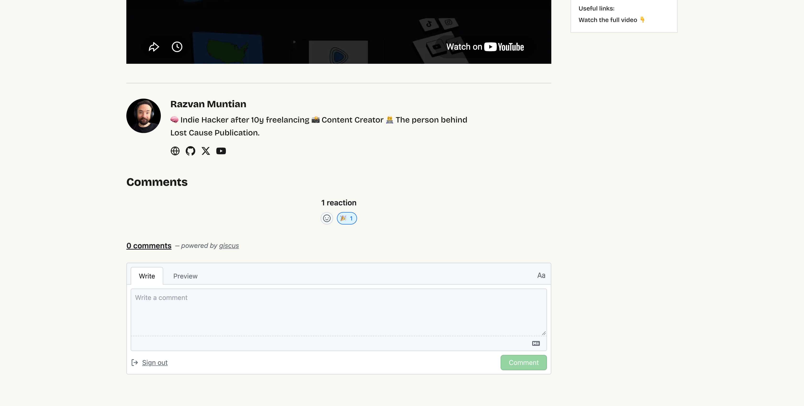

Blogs and communities built around blogs have two important components: on one hand, there's the written blog post. The equally important component is the comments section, where readers can add their input and react to what's been written.

**Lost Cause Publication** started as a static blog, but I want to slowly create a community around it.

The tech stack of the website is simple: the blog is a static website built with Astro, which renders to static HTML pages.

## Astro doesn't support comments

Adding a comments section to a static HTML page isn't possible, other than implementing and deploying a fully featured backend application.

But there's still a solution: there's this project called [giscus](https://giscus.app) that I'm willing to try out. From my understanding, it integrates the [Github Discussions API](https://docs.github.com/en/discussions). That means no backend is required, so the blog stays a static app.

A GitHub account is required to leave a comment. Considering the fact that Lost Cause is a technical blog, probably this won't be such a big issue.

## Enabling giscus

I enabled the Discussions feature for the GitHub repository, and asked Cursor to help me integrate giscus. This is what we got:

It doesn't look bad at all, and it seems to be working fine for a simple and straightforward solution.

## Further reading

- Official Website - https://giscus.app/
- Advanced Configuration - https://github.com/giscus/giscus/blob/main/ADVANCED-USAGE.md
- Github Discussions API - https://docs.github.com/en/discussions

Let's test this feature out! Leave a comment down below 🤩