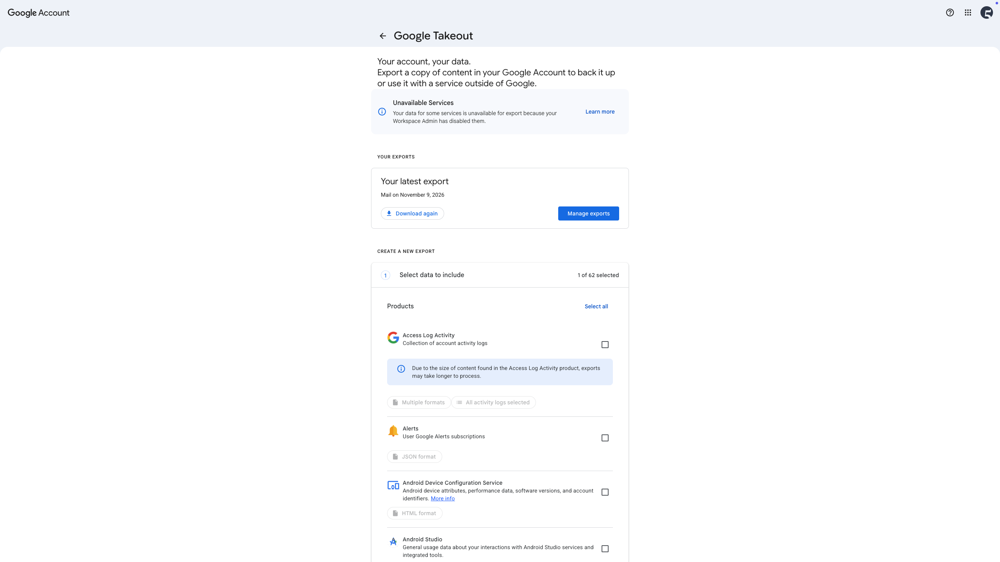
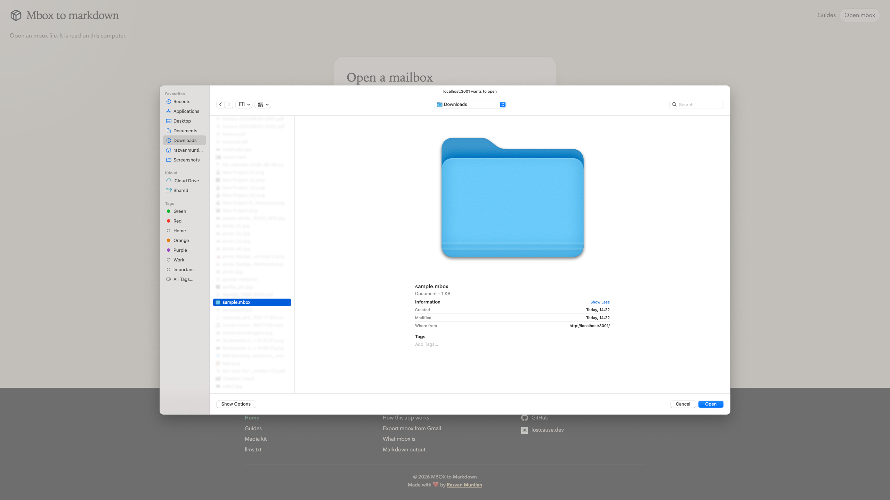
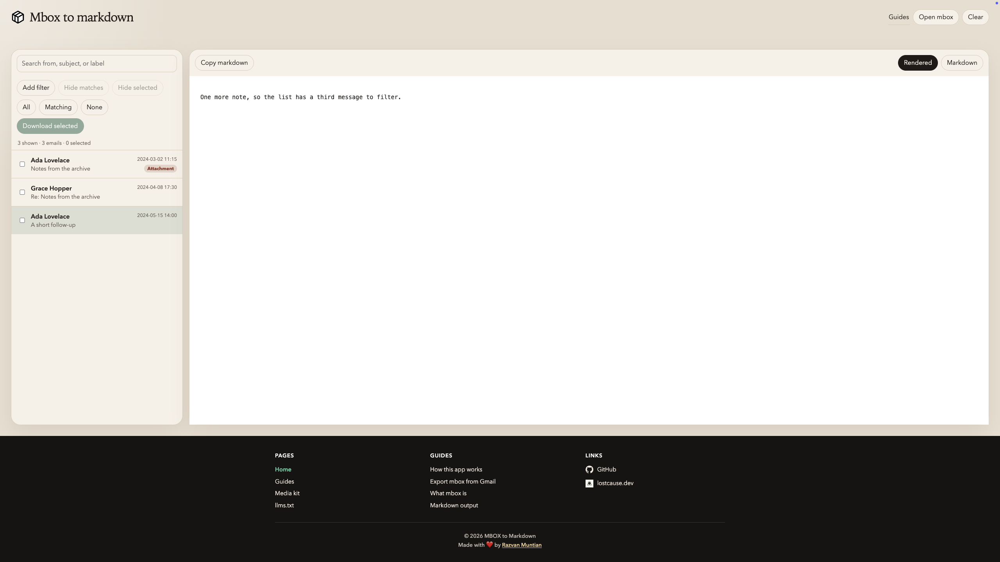
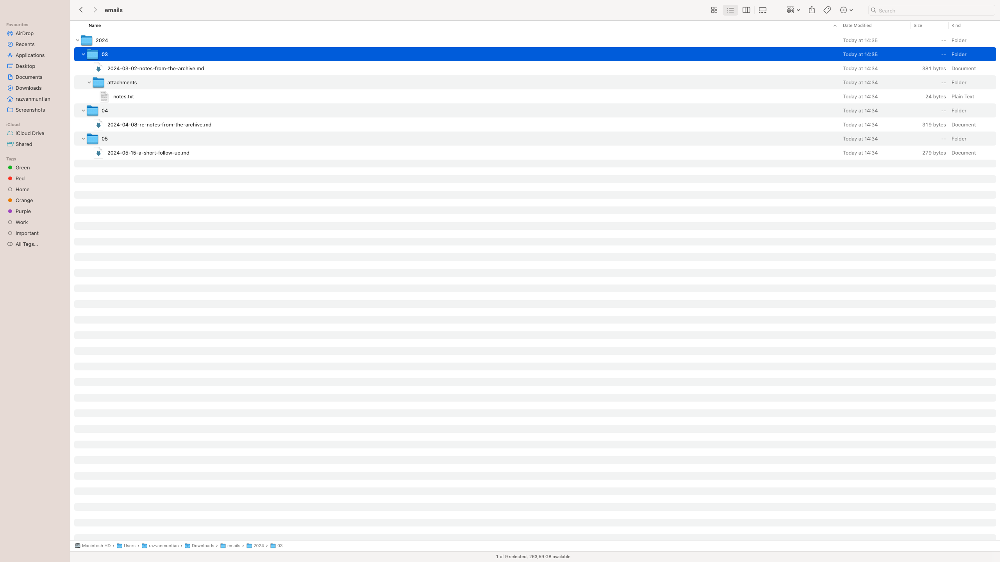
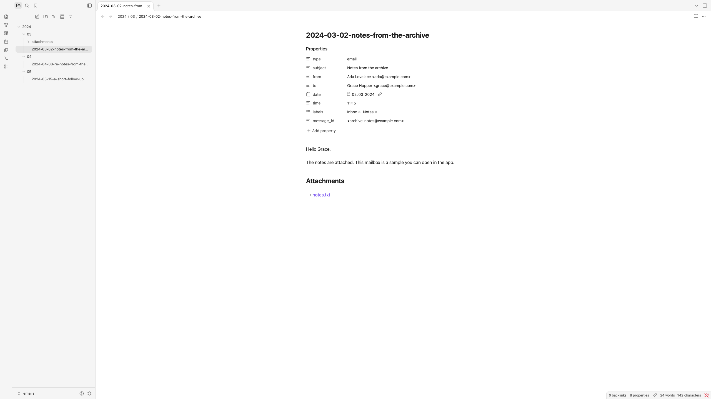

Moving away from one email provider is harder than it seems. If you've used your email for a couple of years, important emails tend to pile up in the archive.

You don't really need them very often, but when you do need something, that's the place too look for an old invoice, or a meeting note from your previous freelancing client.

I had this issue: **how can I backup my emails and move away from an email provider?**

More specifically, how can I export the emails from one of my Gmail accounts?

## My existing setup

On a day-to-day basis, I use [Obsidian](https://obsidian.md/) as my preferred note-taking app. Here everything related to work, personal study, social media, and life in general gets organized and stored.

The reason is simple: Obsidian doesn't have any proprietary format. It works with Markdown files that are stored on my devices. Pretty cool!

## How does the app work

### 1. Get the mbox file



There's this service called [Google Takeout](https://takeout.google.com/) that allows you to export your emails in a .mbox format.

There are more email providers, and they might have a different approach of exporting the emails, but the .mbox format is pretty standard across them.

(For testing purposes, there’s a sample file you can download directly in the app)



### 2. Open the file in the app

Go to [mbox-to-markdown.lostcause.dev](https://mbox-to-markdown.lostcause.dev?ref=lostcausedev) and choose the file. If everything works well, you should be able to see your emails.



### 3. Pick your emails

Search or filter through your emails, preview a message, then tick the ones you want.

### 4. Download the zip

You get `emails.zip` with one note per email, grouped by year and month, with attachments next to each note:

```text
2024/03/2024-03-02-hello.md
2024/03/attachments/notes.pdf
```

Each Markdown file follows this structure:

```yaml
---
type: email
subject: "Hello"
from: "Ada <ada@example.com>"
to: "Grace <grace@example.com>"
date: "2024-03-02"
time: "09:15"
labels:
  - "Inbox"
message_id: "<id@example.com>"
---
```


### 5. Open it in Obsidian

Unzip the archive file you've just downloaded and open it in Obsidian, or copy the year folders into your existing vault.



## Useful links

- [https://mbox-to-markdown.lostcause.dev](https://mbox-to-markdown.lostcause.dev?ref=lostcausedev)
- [https://github.com/razvanmtn/mbox-to-markdown](https://github.com/razvanmtn/mbox-to-markdown)